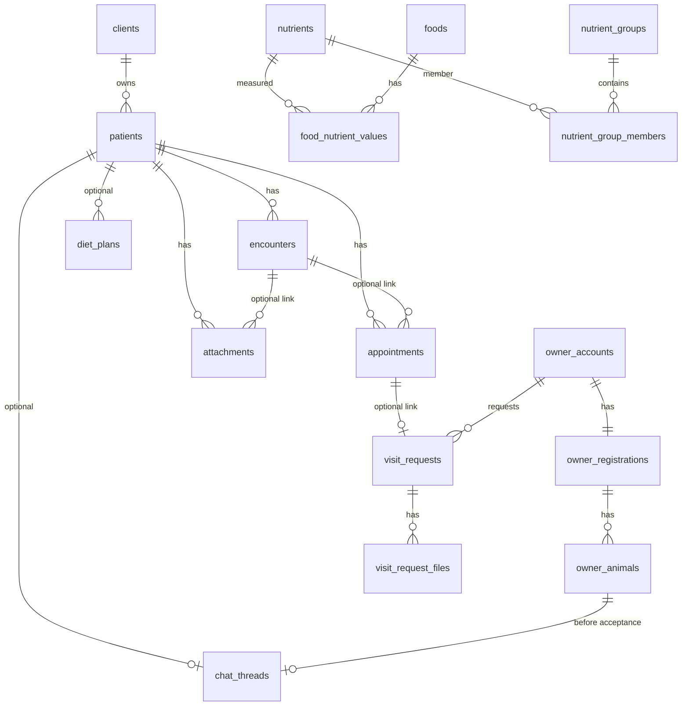

# Project: Vet Space

## Project Description

Vet Space is a veterinary clinical workbench for specialists who manage patients, consultations, and follow-up. The first focus segments are veterinary dermatologists and nutritionists. The product does not replace clinical judgment: calculators and guidance must show sources, versions, and leave the final decision to the clinician.

## Target Users

- Private-practice veterinary nutritionists and dermatologists
- Small specialty clinics and cabinets
- Assistants and admins who schedule visits and owner communications
The roadmap is closed through Telegram Bot Gateway (#12). Client Contacts and Messaging Domain is #13, Clinic Messaging Interface is #14, and Specialty Depth is #15. The clinic workspace runs on an existing VPS.

## Business Model

B2B software for private specialists and small clinics (assumption from current product direction). Monetization details are not fixed.

## Product Vision

Become the primary work window across the treatment cycle: client and patient → scheduled encounter → structured clinical record → reproducible calculations and diet plans → follow-up. Dermatology and nutrition are specialization packs on a shared clinical core, not separate apps.

Near-term emphasis remains a trustworthy FEDIAF 2025 dietetics assistant. The Food catalog is versioned in PostgreSQL. FEDIAF normative values and executable rules live in an in-process Python provider (`vetdietderm_api.standards.fediaf.v2025`, including bundled `normative_data.json`). Provider selection does not consult SQL. TypeScript guideline modules are not in runtime.

The nutrition workbench lets the clinician start from a real Patient or a manual profile, browse the Food catalog as a nutrient table, and assess a ration against FEDIAF for dogs and cats. Catalog browse is a category tree on the catalog tab and the same table inside the ration add dialog. Energy need and nutrient norms are independent clinical questions, joined only by animal-context compatibility. The clinician works a scenario (animal, energy method, nutrient standard, ration). Disease-specific therapeutic nutrient profiles remain a later specialization.

The Owner Cabinet (owner web host, owner API, owner sessions, Telegram Mini App and Login Widget sign-in) is removed from the active runtime. Its full source is archived on branch `archive/owner-cabinet`. The clinician workspace is the system of record. Clinic bot credentials and the staff-side registrations queue and visit requests remain; the per-animal chat API and its staff surfaces are removed, while `chat_threads`, `chat_messages`, and `owner_uploads` stay; existing owner-side data stays in PostgreSQL untouched, and existing owner sessions are revoked by migration `0041_revoke_owner_sessions`. Clinic bot webhooks now receive and persist private Telegram updates. Cycle #13 turns those stored updates into clinic-scoped contacts and conversations and delivers replies. The staff workspace for that conversation is cycle #14.

## Current Functionality

Shipped runtime is a stack of clinic UI in `apps/clinic-web/`, one FastAPI process in `apps/api/`, and an already provisioned PostgreSQL. Prisma is not in the repository. Clinical calculations are not duplicated in React.

Browser calls go to same-origin `/api/*`. A Next.js Route Handler proxies to FastAPI (`API_INTERNAL_URL`). That handler is transport, not the product backend. The API has no `/owner/*` routes and accepts no owner cookie.

`pnpm compose up` starts the API and clinic UI (Alembic on API start; attachments on a named volume). Compose does not start PostgreSQL. Local `uv` + `pnpm dev` is the other run path. The `owner` Compose profile and `owner-web` service were removed.

### Clinic workspace

- Navigation: **Пациенты**, **Расписание**, **Приём**, **Питание**, **Настройки**; home shortcuts to patients, schedule, and nutrition
- Client and Patient are separate. Patients is a split-pane workspace: searchable list, read-only card with explicit edit, tabs **Карточка** / **Приёмы** / **Галерея** / **Питание** (`/patients/{id}?tab=`). `?tab=comms` opens **Карточка**
- Patient card includes sex, allergies, chronic conditions, and feeding notes
- Encounters on the patient card and `/encounter`: specialty (dermatology / nutrition / general), type, statuses draft / in progress / completed
- Structured clinical form builder for anamnesis and exam. Generated clinical text plus optional manual edit. Plan remains free text. Diagnoses, VAS 1–10, autosave
- Visit templates: system structured templates ship in the UI (general primary/recheck, dermatology, nutrition, gastro). Clinic and doctor templates may add a JSON `definition`. `standard` rows stay read-only
- Dermatology gallery: lesion photos and PDFs on disk (`ATTACHMENT_DIR`, 8 MiB, JPEG/PNG/WebP/GIF/PDF), metadata and VAS in PostgreSQL, optional link to an encounter. The «Показывать владельцу» flag is stored, but no owner surface reads it after the Owner Cabinet removal
- Schedule (`/schedule`): day list with visit type and status, create / reschedule / cancel, deep-link to `/encounter?appointmentId=`. A completed appointment can carry one manual ruble amount; marking it paid freezes that amount
- Encounter workspace can start from an appointment or without a slot. The first empty complaint linked from an appointment receives the owner request problem text. A complaint the doctor has written stays as written
- The manual phone-and-email journal, its follow-up time, and table `communications` are removed. This cycle does not replace that follow-up
- Nutrition workspace (`/nutrition`): **Рацион и анализ**, **Недавние планы**, **Каталог Foods**
- Patient picker on the ration tab, or «Без пациента · ручной профиль». `?patientId=` from the patient card prefills. Patient remains optional on save
- Food catalog: category tree with product counts, paged as-fed nutrient matrix, server sorting, 50-row load-more, name search. Empty until a category or search is set. **Добавить продукт** opens that same table in a modal. An incomplete ration total shows `≥` and the known amount. Several source rows for one food, nutrient, and basis resolve to the newest `updated_at`, then the greatest `uuid`. Saved diet-plan snapshots stay frozen
- Ration builder and honest FEDIAF 2025 assessment from the in-process provider. Replace-on-save Diet Plan snapshot includes `provider_version` and `provider_checksum`
- Dog/cat assessments resolve energy formula and nutrient profile on the server from the animal card. `therapeutic_goal` is ignored. Species other than dog and cat skip normative comparison
- Adult standards use imported MER profiles: dog low activity → MER95, other adult dog → MER110; cat indoor/low-activity or neutered → MER75, active adult cat → MER100
- Energy is stored as formula reference kcal and adjusted working kcal. Point formulas use the calculated point; range formulas use the midpoint; a percentage adjustment is applied afterward. RER × factor is a secondary cross-check
- Current, target, and expected mature weights are distinct. Dog size class is derived server-side from expected mature weight
- Relevant input edits mark the visible assessment stale. The response carries `input_hash`; a late response cannot restore an older calculation
- Legacy Diet Plans render as stored. Current-version recalc is an explicit clinician action
- Food rows have no species compatibility filter
- Russian UI, theme toggle, sign-in on the start screen (register, email code, password reset). Clinical routers require the HttpOnly session cookie. `/health` is a public process check. Public `/ready` requires the clinical session and then pings PostgreSQL
- List windows: patients/clients 50, foods 50, diet plans 50, appointments 200

### Clinic door and staff-side owner data

- The clinic is the only clinical tenant. There is no personal-workspace switch and no `X-Vetapp-Workspace` header. A doctor's null-tenant clinical rows move into the clinic on the first clinical session
- Each verified doctor works in one clinic and can join another only when that clinic has no patients and no connected owners. Templates, catalog items, and patient-less diet plans move with the doctor. The empty clinic is deactivated and its bot credential is removed. A clinic that already has patients or owners does not move
- The signed-in profile supplies the doctor label (`display_name`, otherwise email). That label is stored on doctor-scoped catalog and template rows as `doctor_name`. Row isolation for `scope = doctor` uses `created_by`
- Each clinic stores its Telegram bot token and webhook secret in PostgreSQL as Fernet ciphertext. `GET /clinic-bot` exposes the credential status, webhook status, username, public `t.me` link and last error. Owners and admins connect or replace a bot through `PUT /clinic-bot`, which registers this deployment's webhook URL and rotates the secret while preserving the integration ID. Saving requires both the encryption key and public HTTPS base URL. `POST /clinic-bot/verify` checks the URL reported by Telegram and repairs a mismatch with the existing secret when available. `POST /clinic-bot/disconnect` clears the local credentials before asking Telegram to remove the webhook.
- The webhook stores private Telegram updates once in PostgreSQL. The API worker records transport completion, and cycle #13 can select those updates even after the clinic disconnects the bot.
- A transport-complete private Telegram update becomes one inbound conversation message. Repeat deliveries do not insert a second row, and only a newer edit changes the stored message.
- `GET /join-codes/current` returns the clinic's stored code and organization metadata. It returns no owner join link because no owner host exists
- Owner registrations already stored stay in a queue on `/patients` until acceptance. Editors create or select a client and match animals. Clinicians can create clients and patients without owner accounts. No new owner registration can arrive: owner sign-up, sign-in, Telegram Mini App and Login Widget authentication are removed
- The per-animal chat API and the chat in the registration queue are gone. Tables `chat_threads`, `chat_messages`, and `owner_uploads` remain
- The clinic publishes one optional questionnaire. Among existing clinic rows, primary wins; otherwise the latest save wins, with the greater questionnaire id breaking a tie. Owner and admin replace the list; member and viewer can read it. Replacing the list does not change submitted answer snapshots
- Stored visit requests remain. Staff confirm a real start, duration, and one of the four bookable visit types (`primary`, `secondary`, `consultation`, `supervision`); confirming also accepts a pending registration in one transaction. Existing legacy types (`recheck`, `procedure`, `telemedicine`) remain readable
- The pending area on `/patients` has «Регистрации» and «Запросы визитов», outside patient search, refreshing every 30 seconds. Observers can read both groups and download files. Editors confirm or reject

Not shipped: Food `species_compatibility`, knowledge/AI handouts, drug checker, English UI, S3, dose/fluids calculators, signed encounters, backup/restore, online acquiring, owner email notices, in-Telegram booking, clinic-link rotation.

## Product Cycle Roadmap

| # | Status | Stage | Cycle | Product Outcome | PRD / Issues |
| --- | --- | --- | --- | --- | --- |
| 1 | ✅ Done | Core | FEDIAF Stronger | Nutritionist can run a confirmed FEDIAF 2025 happy path on the prototype (JSON SoT, stage confirm, therapeutic gate, Diet Plan `fediafMeta`); NRC/CSV runtime removed. Quality bar was not shipped. | Historical PRD/issues cleaned 2026-08-31 |
| 2 | ❌ Cancelled | Core | FEDIAF Relational Assessment | Trustworthy Postgres-backed ration analysis on the Next/Prisma prototype. Cancelled: the same clinical outcome shipped on the split stack in cycle 3. | Historical PRD cleaned 2026-08-31 |
| 3 | ✅ Done | Core | Split-Stack Nutrition | Nutritionist uses the rebuilt workbench (Next.js UI + one FastAPI process + existing PostgreSQL): Client/Patient, Food catalog, ration, honest FEDIAF 2025 assessment, reproducible saved plan. The therapeutic-goal gate from this cycle was removed in #4. | [PRD](prd/2026-08-28_split-stack-nutrition_prd.md) |
| 4 | ✅ Done | Core | Nutrition Workbench Polish | Nutritionist picks a Patient on `/nutrition`, browses Foods as a category-filtered nutrient table, and always gets a FEDIAF comparison after confirm. Confirmed profile and MER formula were strictly paired until #6. | [PRD](prd/2026-08-29_nutrition-workbench-polish_prd.md) |
| 5 | ✅ Done | Core | Clinical CRM Pivot | Client/Patient/Encounter workspace with schedule, attachments, communications, structured form builder, encounter templates, and accounts with an organization. Signed encounters and encounter-stored calculations remain in Specialty Depth (#15). | — |
| 6 | ✅ Done | Core | Nutrition Context Split | Energy formulas and nutrient profiles stay independent. The server resolves both from the animal card. Adult verdicts use imported MER95/110 and MER75/100 profiles. Stale results cannot look valid. | [PRD](prd/2026-08-29_nutrition-context-split_prd.md) |
| 7 | ✅ Done | Pro | Owner Cabinet | A pet owner registers animals, chats, requests a visit, and downloads files the clinician shares. The later clinic door (#9) replaced doctor-code join and the platform bot. Runtime removed 2026-11-26; source archived on `archive/owner-cabinet`. | [PRD](prd/2026-10-27_owner-cabinet_prd.md) |
| 8 | ✅ Done | Platform | Pilot Hardening | The running API calculates nutrition only with the in-process FEDIAF provider. Public `/ready` requires the clinical session. The container waits for PostgreSQL before the UI starts. Backup and restore stay later. | [PRD](prd/2026-10-27_pilot-hardening_prd.md) |
| 9 | ✅ Done | Pro | Clinic Bot | Each clinic, including a solo doctor, has its own Telegram bot. The administrator pastes the bot token. Owners entered that clinic's cabinet from the bot or from one clinic link (owner entry removed 2026-11-26; clinic bot credentials remain). The personal workspace and the platform bot are gone. Closed 2026-11-07. | [PRD](prd/2026-11-03_clinic-bot_prd.md) |
| 10 | ✅ Done | Pro | Booking by Problem | The owner requests a visit by describing the problem, without choosing a type or specialty. The clinic questionnaire stays optional. After the visit is conducted, the doctor enters one ruble amount and marks it paid. Closed 2026-11-17. | [PRD](prd/2026-11-07_booking-by-problem_prd.md) |
| 11 | ✅ Done | Pro | Catalog Browse | On Расчёт рациона, the nutritionist filters the Food catalog from a category tree, adds a ration food from that same nutrient table in a modal, and reads an incomplete ration total as ≥ the known amount. Closed 2026-11-26. | [PRD](prd/2026-11-25_catalog-browse_prd.md) |
| 12 | ✅ Done | Platform | Telegram Bot Gateway | Each clinic connects, checks, and disconnects its own Telegram bot. The platform verifies the webhook URL, durably receives private updates, and processes them on a PostgreSQL queue inside the existing API process. Staff see bot health. | [PRD](prd/2026-11-26_telegram-bot-gateway_prd.md) (draft) |
| 13 | 🚧 In Progress | Pro | Client Contacts and Messaging Domain | A person who messages the clinic bot becomes a clinic contact with one conversation. The staff API can link a Client, tag a Patient, and deliver a reply. The phone journal and the per-animal chat leave the product. This cycle has no new messaging screens. | [PRD](prd/2026-11-27_client-contacts-messaging_prd.md) (draft) |
| 14 | ⬜ Planned | Pro | Clinic Messaging Interface | Staff read and reply in the clinic workspace: navigation, search, filters, entry from the patient card, a per-staff read state, and a conversation that updates without a full reload. No PRD yet. | — |
| 15 | ⬜ Planned | Pro | Specialty Depth | Stronger derm/nutrition encounter templates, follow-up CRM, signed encounters, encounter-stored calculations, additional clinical calculators (dose, fluids), and disease-specific therapeutic nutrient profiles if still wanted. No PRD yet. | — |

## Product Architecture

- **Clinic web:** Next.js + TypeScript + Tailwind in `apps/clinic-web/`. UI only. Same-origin `/api` Route Handler proxies to FastAPI. Routing and screen composition stay in `app/`; domain UI in `features/`; technical primitives in `shared/`. See [frontend architecture](../apps/clinic-web/ARCHITECTURE.md).
- **Owner web:** removed from the active runtime (archived on branch `archive/owner-cabinet`; see [Owner Web](architecture/owner-web.md)). Shared UI primitives live in `packages/ui`. The proxy helper lives in `packages/web-proxy` and serves the staff audience only.
- **API contract:** FastAPI OpenAPI is the source of truth. `packages/api-contract` holds generated types. `packages/api-client` is the shared HTTP client. Additive `/v1` routes call the same handlers as the existing URLs. See [API contract](api-contract.md).
- **API:** one FastAPI process (Pydantic contracts) with internal bounded contexts (`patients`, `encounters`, `encounter_templates`, `clinical_catalog`, `attachments`, `appointments`, `catalog`, `guidelines`, `assessments`, `standards`, `owners`, `chat`, `visits`, `questionnaires`). Multiple API processes remain deferred.
- **Nutrition standards:** `StandardRegistry` holds immutable in-process providers. Active FEDIAF edition is `fediaf/v2025` (`provider_version` `fediaf/v2025/1.1.0`, engine id `nutrition-engine/2.0.0`). `GET /guidelines/active` and assessments read the provider, not SQL guideline rows.
- **Data:** existing PostgreSQL. No Vercel, no Neon. Docker Compose orchestrates API + clinic UI. Alembic runs to head (`0044_drop_communications`) on API container start.
- **Access:** external module-auth (`MODULE_AUTH_URL`) behind a FastAPI BFF. The browser holds an opaque HttpOnly staff cookie; tokens stay in `browser_sessions`. There is no owner authentication: the API has no owner routes, and `vetapp_owner_session` is not accepted. `require_clinical_access` sets `tenant_id` from the doctor's active organization. Organization viewers are read-only except unsaved assessments. Food catalog writes require global `super_admin`.
- **Core entities:** Client, Patient, Encounter, EncounterTemplate, ClinicalCatalogItem, Appointment, Attachment, Food, Nutrient, Diet Plan, Owner account, Clinic link, Clinic bot, Visit request, Visit questionnaire, Chat thread. FEDIAF edition identity is provider-owned. `guideline_standards` / `guideline_editions` remain in `public` as leftover metadata.
- **Nutrition analysis model:** Animal Context lets the server independently resolve an Energy Formula and a Nutrient Profile. Compatibility is species + physiological context + required fields. Adult verdicts use imported MER95/110 and MER75/100 concentration profiles. Growth and reproduction keep their published life-stage profiles. Table VII-11 stays reference data and is not auto-selected for adults.
- **Later:** clinic contacts, conversation API, and message delivery (#13); clinic messaging workspace (#14); signed encounters and specialty calculators (#15); S3. The manual post-visit charge is not a payment provider. Staff accounts live in module-auth. Client stays the owner and Patient stays the animal.

## Data

Operational source of truth is PostgreSQL for clinical CRM, retained owner-side tables (not dropped), the Food catalog, and Diet Plan snapshots. Schema is Alembic through head `0044_drop_communications`. Primary keys are UUID (UUIDv6). Timestamps are `timestamptz`. Nutrient inventory and assessment honesty rules live in `docs/Nutrient.md`.

FEDIAF normative values, energy formulas, applicability, and derived expressions are not request-path SQL. They load from `apps/api/src/vetdietderm_api/standards/fediaf/v2025/`. Alembic `0019` moved the former runtime tables into schema `legacy_guidelines`. That schema remains and is not on the request path.

Staff accounts and organization membership live in module-auth. Retained owner accounts, clinic links, clinic bot credentials, and pending registrations live in PostgreSQL (owner sessions are revoked and nothing creates new ones). Assessments are not stored as rows: the engine writes one JSON snapshot onto `diet_plans` at save. Lesion binaries, owner uploads, and visit-request files live on disk; PostgreSQL keeps metadata only.

### Relationship map

`encounter_templates` and `clinical_catalog_items` have no foreign keys. `clinic_links` and `clinic_bots` are one row per clinic. `nutrient_aliases` is an unused leftover with no ORM model.

Archived in `legacy_guidelines` (not on the request path): `guideline_profiles`, `guideline_targets`, `energy_formulas`, `applicability_rules`, `derived_expressions`, `source_references`, `growth_size_classes`, `lactation_factors`.

### Clinical CRM

| Table | Role | Notable columns / formats |
| --- | --- | --- |
| `clients` | Owner | `name`, optional `email`, `phone` |
| `patients` | Animal | `species` `dog` \| `cat` \| `other`; `sex` `male` \| `female` \| `unspecified`; weights and `birth_date`; `life_stage`, `activity`; `neutered` / `pregnant` / `lactating`; `bcs` 1–9; `allergies` and `chronic_conditions` JSONB `string[]`; `feeding_notes` |
| `encounters` | Visit | `specialty` `dermatology` \| `nutrition` \| `general`; `type` `appointment` \| `note` \| `diagnostic` \| `treatment`; `status` `draft` \| `in_progress` \| `completed`; SOAP-ish text; `anamnesis_data` JSONB; `diagnoses` JSONB `string[]`; `prescriptions` JSONB; `vas_score`; `occurred_at` |
| `encounter_templates` | Visit templates | `scope` `standard` \| `clinic` \| `doctor`; `section` `anamnesis` \| `exam` \| `plan`; optional JSONB `definition`; optional `doctor_name`. `standard` is read-only |
| `clinical_catalog_items` | Reusable fields/sections | `kind` `field` \| `section`; `scope` `clinic` \| `doctor`; `key`, `label`; JSONB `definition` |
| `appointments` | Schedule | `starts_at`, `duration_min`; new `visit_type` `primary` \| `secondary` \| `consultation` \| `supervision` (legacy `recheck`, `procedure`, `telemedicine` remain readable); `status` `scheduled` \| `completed` \| `cancelled` \| `no_show`; optional `encounter_uuid`; nullable `amount_rub`; `paid` |
| `attachments` | Gallery metadata | `kind` `lesion_photo` \| `document`; caption, region, VAS; `storage_key` under `ATTACHMENT_DIR`; `owner_visible` and `uploaded_by_owner`, default false |

`anamnesis_data` shape used by the form builder: `{ specialty, version, answers, free_text, documents: { anamnesis, exam } }`. Field types: `binary`, `single_select`, `multi_select`, `number`, `text`, `date`. Legacy encounters without `documents` still open via stored text.

Clinical foreign keys that still govern deletes: patients require a client (`RESTRICT`); encounters, appointments, and attachments cascade from the patient; appointment and attachment encounter links `SET NULL`; diet plans `SET NULL` the patient so a plan can exist without one. The manual journal table `communications` is dropped by `0044_drop_communications`. Follow-up on that journal has no replacement in this cycle. `food_nutrient_values` cascades from the food and restricts the nutrient. Identity of a nutrient value is `(food_uuid, nutrient_uuid, basis, source_uuid)`. `source_uuid` has no `Source` table.

### Owner-side tables (retained, no runtime writer)

Owner Cabinet tables are kept as-is after the runtime removal; none is dropped. Only `owner_sessions` and `owner_telegram_exchanges` rows were deleted (migration `0041_revoke_owner_sessions`).

| Table | Role |
| --- | --- |
| `join_codes` / `clinic_links` | One permanent code per clinic. `clinic_links.clinic_id` is the clinic; `code` points at `join_codes` |
| `owner_accounts` / `owner_sessions` | Retained cabinet identity. `owner_sessions` is emptied by migration and never written |
| `owner_telegram_identities` | Retained Telegram bindings, unused |
| `owner_registrations` / `owner_animals` | Pending cabinet animals. Acceptance sets `client_uuid` and `patient_uuid` |
| `clinic_bots` | One encrypted bot credential per clinic (`connected`, `error` or `disconnected`). `bot_id` and `integration_id` are unique. Webhook status is `not_configured`, `active` or `error` |
| `chat_threads` / `chat_messages` | One thread per owner animal and per patient. Messages are immutable text plus author label |
| `owner_uploads` | Owner photo, document, or chat file on disk. Chat rows attach to a message |
| `visit_questionnaires` / `visit_questions` | Clinic questionnaire. One published clinic row is exposed; other clinic rows stay stored |
| `visit_requests` / `visit_request_files` | Problem, proposed time, answer snapshot, status, optional appointment. Files keep their own disk keys |
| `clinic_invite_transfers` | Recovery rows for a doctor moving into an empty clinic |

### Food catalog

| Table | Role | Notable columns / formats |
| --- | --- | --- |
| `nutrients` | Canonical atomic codes (seed `0003_food_catalog`; `0020` canonicalizes units) | `code` unique; `category` `main` \| `mineral` \| `vitamin` \| `amino_acid` \| `fatty_acid`; `base_unit`. Iodine code is `I`. `Se` unit is `mcg` |
| `foods` | Catalog row | `type` `commercial` \| `ingredient` \| `supplement`; `feed_form` `dry` \| `wet` \| `unknown`; browse keys `category` / `subcategory` |
| `food_nutrient_values` | Measured values | `value` numeric nullable (`NULL` ≠ 0); `basis` prefers `per_100g_as_fed`; `value_status` includes `measured`, `calculated`, `estimated`, `trace`, `not_detected`, `unknown` |
| `nutrient_groups` | Derived-ratio groups | Seeded `OMEGA_3` (`ALA`, `EPA`, `DHA`), `OMEGA_6` (`LA`, `AA`) |

Eight import browse categories live on `foods.category`: `сухие корма`, `влажные корма`, `лакомства`, `добавки`, `белки`, `углеводы`, `жиры`, `клетчатка`. Ratios (`Ca/P`, `ω6/ω3`, `/DM`, `/ME`) are calculated, never `nutrients` rows. Mapping detail is in `docs/Nutrient.md`.

### FEDIAF guidelines (provider, not SQL runtime)

Runtime engine reads the active in-process provider. Bundled snapshot: `apps/api/src/vetdietderm_api/standards/fediaf/v2025/normative_data.json` (edition `2025.09`). `provider_checksum` hashes the provider package files.

| Piece | Role |
| --- | --- |
| `StandardRegistry` | Maps `(standard_code, edition)` → provider; `active()` is FEDIAF 2025 |
| `Fediaf2025Provider` | `assess`, `suggest`, `estimate_energy`, `context_options` |
| `guideline_standards` / `guideline_editions` | Leftover public metadata; not consulted by `/guidelines` or `/assessments` |
| `legacy_guidelines.*` | Archived SQL runtime from before `0019` |
| SQL FEDIAF import / publish | Not in the API process |

Adult auto-select uses `dog_adult_mer95` / `dog_adult_mer110` and `cat_adult_mer75` / `cat_adult_mer100`. External publication: [FEDIAF Nutritional Guidelines 2025](https://europeanpetfood.org/wp-content/uploads/2025/09/FEDIAF-Nutritional-Guidelines_2025-ONLINE.pdf).

### Diet plans

| Table | Role | Notable columns / formats |
| --- | --- | --- |
| `diet_plans` | Saved ration + snapshot | `name`; optional `patient_uuid`; `notes`; `ration_json` JSONB; `assessment_snapshot_json` JSONB. One snapshot per save. Read path does not recompute |

`ration_json` is `[{ food_uuid, grams, food_name, food_type, feed_form }, ...]`.

`assessment_snapshot_json` carries `request`, `assessment` / `result`, resolved profile and formula codes, `standard_code`, `edition`, `provider_version`, `provider_checksum`, and `resolved_context`. Missing provenance on old rows maps to `provider_version=legacy/sql`. Legacy snapshots may still use `body_weight_kg` / `expected_adult_weight_kg`; the read mapper accepts those aliases.

### Import artifacts

Never opened by FastAPI request handlers or Next.js. Catalog import is the operator path into PostgreSQL. FEDIAF JSON under `docs/data/` is an archive of the provider snapshot, not the live engine load.

| File | Format | Maps to |
| --- | --- | --- |
| `apps/api/data/products_normalized.json` | JSON array of food objects | `foods` + `food_nutrient_values` via `vetdietderm_api.catalog.import_products` |
| `apps/api/src/vetdietderm_api/standards/fediaf/v2025/normative_data.json` | JSON object, edition `2025.09` | in-process provider |
| `docs/data/fediaf_2025_veterinary_nutrition_database_ru.json` | JSON object | archival twin; not loaded by the API |
| `docs/data/fediaf_2025_veterinary_nutrition_schema.json` | JSON Schema 2020-12 | validates the FEDIAF snapshot |
| `docs/data/fediaf_2025_*.csv`, `docs/data/fediaf_2025_veterinary_nutrition_ru.xlsx` | CSV / XLSX | archival only |

### Off-database storage

| Store | What |
| --- | --- |
| PostgreSQL | Clinical CRM, owner cabinet, Food catalog, Diet Plan snapshots, leftover guideline metadata |
| Provider package | FEDIAF normative data and executable rules |
| `ATTACHMENT_DIR` on disk | Lesion originals, owner uploads, and visit-request files. Compose uses named volume `attachments`. No base64 in primary tables. S3 is later |

## Data, Integrations, and Constraints

- Operational source of truth: PostgreSQL for CRM, cabinet, catalog, and saved plans; in-process FEDIAF provider for assessment. Nutrient semantics: `docs/Nutrient.md`.
- Import artifacts under `docs/data/` are operator CLI or archives. Request handlers do not read those JSON/CSV/XLSX files.
- Clinical outputs remain informational (`GET /guidelines/active` `clinical_warning_ru`).
- UI language: Russian. FEDIAF provider content is Russian.
- Compose binds the clinic UI to `127.0.0.1:3003` and the API to `127.0.0.1:8001`. The only nginx location that forwards directly to FastAPI is `/telegram/webhooks/`. The UI and `/api` requests go to Next.js. Remove the former owner host's nginx route for `127.0.0.1:3004`.

## Known Decisions

- Prototype Prisma runtime is gone. Catalog was imported into PostgreSQL. FEDIAF runtime moved from SQL tables to an in-process provider in `0019`. Schema `legacy_guidelines` stays.
- Happy path works with and without a saved Patient. Nutrition-session overrides, including target body weight, are not written back to the Patient card.
- Client and Patient are separate. The patient card is read-only until the clinician starts an explicit edit.
- A clinic contact stores an immutable Telegram user id and chat id, a staff-editable local name, and at most one Client, with one conversation per contact.
- Each change to a contact's Client link appends an immutable event to that contact's audit history. This cycle has no clinic-wide audit screen.
- One Food catalog. Browse is a category tree, and ration add is a catalog-style modal. Browse stays category-based. Stored `type` remains on the Food row.
- An incomplete ration total shows `≥` and the sum of known contributions in the Итого row. The normative status does not change.
- Catalog table is the primary catalog view: sticky food name, nutrient columns by group, values on `per_100g_as_fed`. Empty until a category or name search. Page size 50 with load-more. Missing values sort last.
- Energy-formula and nutrient-profile inference is server-owned. The client neither selects nor submits the codes. An energy formula does not own exactly one nutrient profile. Compatibility 422 remains for species mismatch, invalid physiological context, and missing required fields.
- Adult profile resolution is deterministic: dog `activity=low` → `dog_adult_mer95`, other adult activity → `dog_adult_mer110`; cat neutered or low-activity/indoor → `cat_adult_mer75`, otherwise → `cat_adult_mer100`.
- `current_body_weight_kg`, `target_body_weight_kg`, and `expected_mature_weight_kg` are distinct. Expected mature weight drives dog growth and server-derived size class.
- `working_energy_kcal = reference_energy_kcal × energy_adjustment_percent / 100`. RER × factor is a secondary cross-check.
- No therapeutic-goal control in the UI. Disease-specific therapeutic profiles stay later.
- Canonical nutrient is atomic. Composites are calculated. Null is never zero and never counts as a met minimum.
- One assessment snapshot per Diet Plan save, replaced on the next save.
- Food `species_compatibility` is not in the product.
- Encounter anamnesis and exam are structured documents. Plan stays free text.
- The clinic is the only clinical tenant. A doctor joins a second clinic only when that clinic is empty of patients and owners.
- Owner entry (clinic bot, clinic link, email sign-in) is removed. Clinic bot credentials stay in PostgreSQL for the staff settings screen. No owner cookie opens any route.
- The owner describes the visit problem and does not choose a type or specialty. One clinic questionnaire, optional answers. After a conducted visit the doctor enters one ruble amount and marks it paid.
- Lesion originals, owner uploads, and request files live on disk. Compose does not auto-import an existing `data/attachments` tree.
- Next Route Handlers stay the public `/api` path for staff calls. nginx publishes one Telegram webhook path to FastAPI on loopback. The bot token and webhook secret stay off the staff screen, out of logs, and out of stored error text.
- One worker in the FastAPI process atomically claims PostgreSQL updates for all clinics. On restart it requeues unfinished claims below the three-attempt limit. Business processing selects transport-complete `telegram_updates` whose `business_consumed_at` is null. Disconnect keeps those rows.
- The webhook resolves the clinic from the stored integration ID and authenticates the Telegram secret header. It commits private `message` and `edited_message` updates to `telegram_updates` before acknowledging them. Retries for the same bot ID and update ID and all other update kinds are acknowledged without inserting a row. Disconnect stops local intake and retains stored updates even when Telegram does not remove the webhook.
- Online acquiring, a price list, prepayment, no-show fees, owner email, clinic-link rotation, in-Telegram booking, and moving a populated clinic stay later.
- Clinic messaging is a clinic-scoped Telegram contact and one conversation per contact. It replaces the owner-account thread and the thread per animal. Cycle #13 is the domain, API, migration, and delivery. Cycle #14 is the staff workspace. A Telegram user id does not by itself allow a send: the person must have written to the current clinic bot.

## Cycle History

- 2026-08-28 — Cycle 2 **FEDIAF Relational Assessment** was cancelled. The clinical outcome moved to Split-Stack Nutrition (#3) instead of an in-place Prisma cutover.
- 2026-08-30 — Cycle #6 **Nutrition Context Split** closed. Energy and nutrient standards are independent. Food species gating stayed out.
- 2026-10-27 — Cycle #5 closed on the shipped CRM workspace. Signed encounters and encounter-stored calculations moved to Specialty Depth. Cycle #8 **Pilot Hardening** closed the same day: SQL FEDIAF import/publish left the API, and public `/ready` requires the clinical session.
- 2026-11-03 — Cycle #7 **Owner Cabinet** closed on the shipped cabinet.
- 2026-11-07 — Cycle #9 **Clinic Bot** closed. The personal workspace and the platform bot were removed. Specialty Depth moved to #11.
- 2026-11-17 — Cycle #10 **Booking by Problem** closed on the problem request, one optional clinic questionnaire, staff visit classification, and one manual ruble charge. Specialty Depth was recorded as the next cycle. No PRD was written for it.
- 2026-11-25 — **Catalog Browse** was inserted as #11 ahead of Specialty Depth. Specialty Depth moved to #12 and still has no PRD. The Catalog Browse PRD is a draft.
- 2026-11-26 — Owner Cabinet runtime removed from `main` (owner-web, owner-features, owner auth/API, Mini App/widget). Source frozen on `archive/owner-cabinet`. Clinic bot credentials and staff queues retained; owner sessions revoked by Alembic `0041`.
- 2026-11-26 — Catalog Browse (#11) closed. The clinic nutrition UI has the category tree, the ration-add catalog modal, and the `≥` lower bound. Telegram Bot Gateway is #12. Clinic Telegram Conversation is #13. Specialty Depth moved to #14.
- 2026-11-27 — Clinic Telegram Conversation (#13) was defined as **Client Contacts and Messaging Domain**: domain, API, migration, and delivery, with a draft PRD. The staff workspace was inserted as **Clinic Messaging Interface** (#14). Specialty Depth moved to #15.

## Open Product Questions

- Concrete B2B pricing and packaging
- Whether leftover `guideline_standards` / `guideline_editions` rows and the `legacy_guidelines` schema should later be dropped
- Whether archival CSV/XLSX and the `docs/data/` FEDIAF JSON twin should later be deleted or kept as source archives
- Whether complementary-food scenarios eventually need a dedicated analysis path
- What `source_uuid` on food nutrient values represents, and whether Source has a clinician UI later
- When to extract FastAPI modules into separate processes
- Whether English UI returns as a later cycle or stays Russian-only
- Whether a later cycle writes nutrition-session overrides, including target body weight, back onto the Patient card
- Whether a later cycle adds Food `species_compatibility` and species-filtered ration search
- Whether archival adult density standards (`dog_adult_density_95/110`, `cat_adult_density_75/100`) later get a clinician cross-check, or stay data-only
- When backup and restore of the clinical database and gallery files become their own cycle
- Whether `/settings` later hosts clinic/doctor catalog editing, or that stays inside the encounter workspace
- When owner email returns (verification, password reset, chat and appointment notices)
- When a clinician can rotate a leaked clinic link
- When online visit payment returns beyond the manual ruble amount
- When a doctor can move a clinic that already has patients or connected owners
- When the clinic bot sends visit and chat notices, or accepts a booking inside Telegram. Contact, conversation, and delivery are cycle #13; the staff workspace is cycle #14. Notices and in-Telegram booking stay outside both
