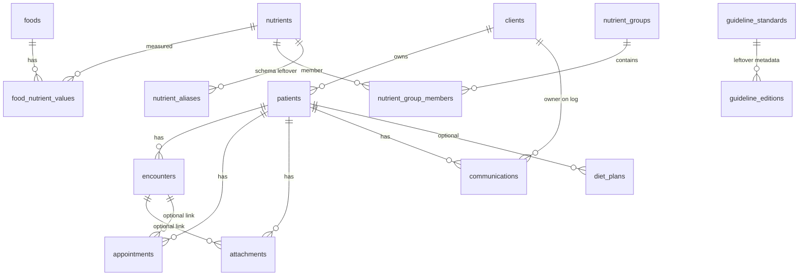

# Project: VetDietDerm

## Project Description

VetDietDerm is a veterinary clinical workbench for specialists who manage patients, consultations, and follow-up. The first focus segments are veterinary dermatologists and nutritionists. The product does not replace clinical judgment: calculators and guidance must show sources, versions, and leave the final decision to the clinician.

## Target Users

- Private-practice veterinary nutritionists and dermatologists
- Small specialty clinics and cabinets
- Assistants and admins who schedule visits and owner communications (later CRM depth)
- Pet owners who join one doctor's practice through that doctor's code or link (cabinet join, profile and animal passports shipped)

Core cycles #1–#6 and Platform cycle #8 Pilot Hardening are closed. Clinical CRM Pivot (#5) closed on the shipped workspace; signed encounters and encounter-stored calculations sit in Specialty Depth (#9). Cycle #7 Owner Cabinet is in progress (join, profile, animal passports and registration acceptance implemented). Deployment on an existing VPS is in use.

## Business Model

B2B software for private specialists and small clinics (assumption from current product direction). Monetization details are not fixed.

## Product Vision

Become the primary work window across the treatment cycle: client and patient → scheduled encounter → structured clinical record → reproducible calculations and diet plans → follow-up. Dermatology and nutrition are specialization packs on a shared clinical core, not separate apps.

Near-term product emphasis: a trustworthy FEDIAF 2025 dietetics assistant on a split stack (Next.js UI, FastAPI API, PostgreSQL). The Food catalog is versioned in PostgreSQL. FEDIAF normative values and executable rules live in an in-process Python provider (`vetdietderm_api.standards.fediaf.v2025`, including bundled `normative_data.json`). Provider selection never consults SQL. TypeScript guideline modules are not in runtime.

The nutrition workbench lets the clinician start from a real Patient (or a manual profile), browse the Food catalog as a nutrient table, and assess a ration against FEDIAF for dogs and cats. Energy need and nutrient norms are independent clinical questions, joined only by animal-context compatibility — not by an application-owned `energy_formula → nutrient_profile` pair. The clinician works a scenario (animal, energy method, nutrient standard, ration), not internal database objects. Disease-specific therapeutic nutrient profiles remain a later specialization, not a hidden switch that blanks the current analysis.

The rebuild laid a foundation for CRM and specialty packs: separate Client and Patient, modular API bounded contexts, one FastAPI process that can be split later. Clinical encounters, structured form builder, templates, attachments, appointments, and communications now sit on that core.

The next product surface is the owner's cabinet. The pet owner joins one doctor through that doctor's code, registers their animals, chats with the practice, and requests a visit with that doctor's questionnaire and files. The clinician workspace stays the system of record. Specialty depth follows the cabinet.

## Current Functionality

Shipped runtime is the **split stack**: Next.js UI in `frontend/`, one FastAPI process in `apps/api/`, PostgreSQL (already provisioned; local/VPS example `127.0.0.1:15432` or Docker-network hostname). Prisma is not in runtime. Clinical calculations are not duplicated in React.

Browser calls go to same-origin `/api/*` when `NEXT_PUBLIC_API_URL=/api`. A Next.js Route Handler (`frontend/src/app/api/[...path]/route.ts`) proxies to FastAPI (`API_INTERNAL_URL`). That handler is transport, not the product backend.

Supported run paths: `docker compose up` (API + frontend; Alembic on API start; attachments named volume) or local `uv` + `npm run dev`. Compose does not start PostgreSQL.

- Navigation: **Пациенты**, **Расписание**, **Приём**, **Питание**, **Настройки**; home shortcuts to patients, schedule, and nutrition
- Client and Patient as separate entities. Patients is a split-pane workspace: searchable list, read-only card with explicit edit, tabs **Карточка** / **Приёмы** / **Галерея** / **Коммуникации** / **Питание** (`/patients/{id}?tab=`)
- Patient card fields include allergies, chronic conditions, and feeding notes
- Owner registrations stay in a separate queue on `/patients`, outside patient/client lists and search until acceptance. Editors explicitly create or select a client and match animals in the invitation's workspace; observers can only read the queue. After linking, the owner sees and edits passports of every patient on that client, adds patients immediately, and keeps client contact details synchronized. Clinical fields stay private. Clinicians can still create clients and patients without owner accounts. Requires migration `0025_registration_acceptance`.
- Each animal has one text conversation, available to the owner and the registration queue before acceptance. Acceptance retains the same history on the patient «Коммуникации» tab beside the separate communication log. Personal conversations belong to the inviting doctor; organization editors reply and observers read. Owners see all staff replies under their inviting doctor's name. No attachments, edits, deletion or notifications. Requires migration `0026_animal_chat`.
- The owner downloads a gallery file only after the clinician turns on «Показывать владельцу». Existing files stay clinician-only, and linking a client does not share that client's old gallery. Before acceptance the cabinet does not list files. Requires migration `0027_owner_file_visibility`.
- The inviting doctor publishes one questionnaire per bookable visit type (`primary`, `secondary`, `consultation`, `supervision`) from `/settings`. Lists belong to the signed-in doctor's `user_id`, independently of workspace; other doctors cannot read or edit them. Replacing a list, including an empty list, does not create an encounter or change submitted answers. Requires migration `0028_visit_questionnaires`.
- From the animal card, the owner proposes a visit time, answers every published question and attaches photos/PDFs (up to 8 MiB each). The request stays off the day schedule until staff confirm a real start and duration; confirming also accepts a pending registration in one transaction. Reject/withdraw retain downloadable request files; cancel and clinician appointment changes synchronize the owner status without exposing encounter text. New appointments use only `primary`, `secondary`, `consultation`, `supervision`; existing `recheck`, `procedure`, `telemedicine` remain readable and can retain their type on edit. Requires migration `0029_visit_requests`. Confirm/reject and the staff request list are APIs; the clinician pending-list UI remains a separate issue.
- Encounters on the patient card and `/encounter`: specialty (dermatology / nutrition / general), type, statuses draft / in progress / completed
- Structured clinical form builder for anamnesis and exam (system field/section catalog in the UI, plus clinic/doctor catalog items in PostgreSQL). Generated clinical text plus optional manual edit. Plan remains free text. Diagnoses, VAS 1–10, autosave
- Visit templates: system structured templates (general primary/recheck, dermatology, nutrition, gastro) shipped in the UI; clinic/doctor templates may add a JSON `definition`. Legacy snippet `body` still exists on `encounter_templates`. `standard` rows in the database stay read-only
- Accounts and an optional organization come from external module-auth. The signed-in profile supplies the doctor label (`display_name`, otherwise email). That label is stored on personal catalog and template rows as `doctor_name`; row isolation uses `created_by`, not the label
- Dermatology gallery: lesion photos and PDFs stored on disk (`ATTACHMENT_DIR`, 8 MiB, JPEG/PNG/WebP/GIF/PDF), metadata and VAS in PostgreSQL, optional link to an encounter
- Schedule (`/schedule`): day list of appointments with visit type and status, create / reschedule / cancel, deep-link to `/encounter?appointmentId=`
- Encounter workspace can start from an appointment (loads `GET /appointments/{id}`) or without a slot (server-side patient search). Unfiltered appointment lists are newest-first and capped at 200
- Communication log on the patient card (channel, direction, follow-up time)
- Nutrition workspace (`/nutrition`) tabs: **Рацион и анализ**, **Недавние планы**, **Каталог Foods**
- Patient picker on the ration tab: search by animal or owner, or stay on «Без пациента · ручной профиль»; `?patientId=` from the patient card still prefills; Patient remains optional on save
- Food catalog: category/subcategory panel (eight import buckets; subcategories mostly brands, with in-panel subcategory search), paged as-fed nutrient matrix by SPEC group, server sorting, 50-row load-more, name search; empty until a category or search is set
- Ration builder; honest FEDIAF 2025 assessment from the in-process provider; replace-on-save Diet Plan snapshot (includes `provider_version` / `provider_checksum`)
- Dog/cat assessments resolve `energy_formula_code` and `nutrient_profile_code` on the server from the animal card; exact profile/formula pairing is not a 422. `therapeutic_goal` remains an ignored compatibility field
- Adult standards use imported MER profiles automatically: dog low activity → MER95, other adult dog → MER110; cat indoor/low-activity or neutered → MER75, active adult cat → MER100. Table VII-11 remains stored as reference data inside the provider snapshot
- Energy is stored as formula reference kcal and adjusted working kcal. Point formulas use the calculated point; range formulas use the midpoint; a percentage adjustment is applied afterward. RER × factor is a secondary cross-check
- Current, target, and expected mature weights are distinct; dog size class is derived server-side from expected mature weight with no UI override
- Relevant input edits mark the visible assessment stale; the response carries `input_hash`; late responses cannot restore an older calculation
- Legacy Diet Plans render as stored without remap or auto-recompute (`provider_version` defaults to `legacy/sql` on read). Current-version recalc is an explicit clinician action
- Food rows have no species compatibility; ration search does not filter cat-only commercial foods away from a dog patient
- Canonical iodine code is `I` (migration `0020` renamed leftover `J`); selenium catalog unit is `mcg`
- Russian UI, theme toggle (header and `/settings`), sign-in on the start screen (register, email code, password reset). Clinical routers require the HttpOnly session cookie. `/health` stays a public process check; public `/ready` requires the clinical session and then pings PostgreSQL. Compose healthcheck probes the database in-process inside the API container
- SQL FEDIAF import and publish are not in the API process; normative values load only from the in-process FEDIAF 2025 provider. Schema `legacy_guidelines` remains
- List windows: patients/clients 50, foods 50, diet plans 50, appointments 200

Not shipped: Food `species_compatibility` (dropped from cycle #6), clinician pending-list UI for visit requests (#7), knowledge/AI handouts, drug checker, English UI, S3, dose/fluids calculators, signed encounters, backup/restore. Accounts and organization roles ship through module-auth. Prisma is not in the repository.

## Product Cycle Roadmap

| # | Status | Stage | Cycle | Product Outcome | PRD / Issues |
| --- | --- | --- | --- | --- | --- |
| 1 | ✅ Done | Core | FEDIAF Stronger | Nutritionist can run a confirmed FEDIAF 2025 happy path on the prototype (JSON SoT, stage confirm, therapeutic gate, Diet Plan `fediafMeta`); NRC/CSV runtime removed. Quality bar was not shipped. | Historical PRD/issues cleaned 2026-08-31 |
| 2 | ❌ Cancelled | Core | FEDIAF Relational Assessment | Trustworthy Postgres-backed ration analysis on the Next/Prisma prototype. Cancelled: same clinical outcome is delivered on a new stack in cycle 3; in-place Prisma refactor was rejected. | Historical PRD cleaned 2026-08-31 |
| 3 | ✅ Done | Core | Split-Stack Nutrition | Nutritionist uses a rebuilt workbench (Next.js UI + one FastAPI process + existing PostgreSQL): Client/Patient, Food catalog, ration, honest FEDIAF 2025 assessment, reproducible saved plan. Legacy prototype modules left runtime. Therapeutic-goal gate from this cycle was later removed in #4. | [PRD](prd/2026-08-28_split-stack-nutrition_prd.md) |
| 4 | ✅ Done | Core | Nutrition Workbench Polish | Nutritionist picks a Patient on `/nutrition`, browses Foods as a category-filtered nutrient table, and always gets a FEDIAF comparison after confirm — no therapeutic-goal switch. Confirmed profile and MER formula were strictly paired until #6. | [PRD](prd/2026-08-29_nutrition-workbench-polish_prd.md) |
| 5 | ✅ Done | Core | Clinical CRM Pivot | Client/Patient/Encounter workspace with schedule, attachments, communications, structured form builder, encounter templates, and accounts with an optional organization. Signed encounters and encounter-stored calculations moved to Specialty Depth (#9). | — |
| 6 | ✅ Done | Core | Nutrition Context Split | Energy formulas and nutrient profiles remain independent; the server resolves both from the animal card, adult verdicts use imported MER95/110 and MER75/100 profiles, and stale results cannot look valid. | [PRD](prd/2026-08-29_nutrition-context-split_prd.md) |
| 7 | 🚧 In Progress | Pro | Owner Cabinet | A pet owner joins one doctor by code or link, registers their animals, chats, requests a visit with that doctor's questionnaire and files, and downloads only files the clinician shares. | [PRD](prd/2026-10-27_owner-cabinet_prd.md) (draft) |
| 8 | ✅ Done | Platform | Pilot Hardening | The running API calculates nutrition only with the in-process FEDIAF provider. Public `/ready` requires the clinical session. The container still waits for PostgreSQL before the UI starts. Backup and restore stay later. | [PRD](prd/2026-10-27_pilot-hardening_prd.md) |
| 9 | ⬜ Planned | Pro | Specialty Depth | Stronger derm/nutrition encounter templates, follow-up CRM, signed encounters, encounter-stored calculations, additional clinical calculators (dose, fluids), and disease-specific therapeutic nutrient profiles if still wanted. Moved from #7 on 2026-10-27. Not the next cycle. | — |

## Product Architecture

- **Web:** Next.js + TypeScript + Tailwind in `frontend/` — UI only. Same-origin `/api` Route Handler is a proxy to FastAPI. No Prisma. Clinical calculations are not duplicated in React. System clinical field/section catalog lives in `frontend/src/lib/clinical-builder.ts`.
- **API:** one FastAPI process (Pydantic contracts) with internal bounded contexts (`patients`, `encounters`, `encounter_templates`, `clinical_catalog`, `attachments`, `appointments`, `communications`, `catalog`, `guidelines`, `assessments`, `standards`). Module boundaries are the foundation for later extraction; multiple API processes remain deferred.
- **Nutrition standards:** `StandardRegistry` holds immutable in-process providers. Active FEDIAF edition is `fediaf/v2025` (`provider_version` `fediaf/v2025/1.1.0`, engine id `nutrition-engine/2.0.0`). `GET /guidelines/active` and assessments read the provider, not SQL guideline rows.
- **Data:** existing PostgreSQL (local published port or Docker-network host such as `pgsql`). No Vercel, no Neon. Docker Compose orchestrates API + frontend only; PostgreSQL stays an already-provisioned instance. Alembic runs to head (`0029_visit_requests`) on API container start.
- **Access:** external module-auth (`MODULE_AUTH_URL`) behind a FastAPI BFF. The browser holds an opaque HttpOnly cookie; tokens stay in `browser_sessions`. Clinical routers require an active verified staff account and read only `vetapp_session`. Owners use the separate HttpOnly `vetapp_owner_session` cookie; neither session opens the other surface. Owner passwords use per-account salted scrypt in PostgreSQL; owner registration sends no email. `X-Vetapp-Workspace` is `personal` or `organization`. Personal rows use `tenant_id` NULL and `created_by` equal to the user. Rows with both NULL stay inaccessible. Organization observers are read-only except unsaved assessments. Food catalog writes require global `super_admin`.
- **Core entities:** Client, Patient, Encounter, EncounterTemplate, ClinicalCatalogItem, Appointment, Attachment, Communication, Food, Nutrient, Diet Plan. FEDIAF edition identity is provider-owned; `guideline_standards` / `guideline_editions` remain in `public` as leftover metadata. Physical tables, keys, JSONB payloads, and import formats are in [Data](#data).
- **Nutrition analysis model:** Animal Context lets the server independently resolve an Energy Formula and Nutrient Profile. Compatibility is species + physiological context + required fields — not `energy_formula.profile_id`. Adult verdicts use imported MER95/110 and MER75/100 concentration profiles; growth and reproduction keep their published life-stage profiles. Table VII-11 remains available as reference data but is not auto-selected for adults.
- **Owner passports:** owners add and edit name, species, breed, sex and birth date. Pending animals stay in `owner_animals` and are absent from patients, clients and clinical search until acceptance. Migration `0025` links registrations to clients and pending animals to patients; after acceptance, passport reads and writes use every patient of the linked client, scoped to the invitation workspace. `accept_registration(session, registration_id, payload)` validates permissions and matches and flushes atomically; its caller supplies verified staff in `session.info['user']` and owns commit. Owner routes use a plain session with explicit workspace predicates, independent of the clinician's current workspace. Patient cards include sex (male/female/unspecified; migration `0024`).
- **Animal chat:** `chat_threads` has unique nullable owner-animal and patient references; `chat_messages` stores immutable text, author identity and sender label at send time. These tables use explicit authorization rather than `TenantOwned`. Registration and patient locks serialize first sends with acceptance. Matching a patient with an existing conversation retains both histories in the pending thread. Message sends never create `communications` rows.
- **Visit questionnaires:** `visit_questionnaires` (unique doctor `user_id` + visit type) and ordered `visit_questions` (kind, label, JSONB options), outside tenant-owned clinical records. Answers are immutable JSONB snapshots on `visit_requests`, including question id, label, kind, submitted value and select options at submission.
- **Visit requests:** explicit owner and invitation-workspace authorization; registration and request locks serialize acceptance, confirmation, withdrawal and file upload. Confirmation flushes acceptance and one appointment before a single commit. `visit_request_files` stores disk keys and a gallery-copy marker; gallery rows use `create_attachment(commit=False)` with both owner flags. Gallery copies have separate disk keys so deleting a gallery file cannot break the retained request download. Appointment PATCH copies start, duration and status back; deleting a linked appointment cancels its request.
- **Later entities:** remaining owner pending-list UI (#7, not shipped); signed encounter and specialty calculators (#9); S3 object store. Staff accounts live in module-auth. Client stays the owner and Patient stays the animal.
- Disease-specific therapeutic profiles are not a product mode. Species other than dog/cat still skip normative comparison.

## Data

Operational source of truth is PostgreSQL for clinical CRM, the Food catalog, and Diet Plan snapshots. Schema is Alembic through `0022_users_organizations`. Primary keys are UUID (UUIDv6). Timestamps are `timestamptz`. Nutrient inventory and assessment honesty rules live in `docs/Nutrient.md`; this chapter is the table, relationship, and format map.

FEDIAF normative values, energy formulas, applicability, and derived expressions are **not** request-path SQL. They load from `apps/api/src/vetdietderm_api/standards/fediaf/v2025/`. Alembic `0019` moved the former runtime tables into schema `legacy_guidelines`. SQL FEDIAF import and publish are not in the API process; schema `legacy_guidelines` remains.

Staff accounts and organization membership live in module-auth. Owner accounts, scrypt password hashes, sessions, stable join codes, staff email reservations, and pending registrations live in PostgreSQL (migration `0023`). Migration `0022` adds nullable `tenant_id` and `created_by` on clinical tables and stores opaque browser sessions in `browser_sessions`. Assessments are not stored as rows: the engine writes one JSON snapshot onto `diet_plans` at save. Lesion binaries live on disk; PostgreSQL keeps metadata only.

### Relationship map

`encounter_templates` and `clinical_catalog_items` have no foreign keys.

Archived in `legacy_guidelines` (not on the request path): `guideline_profiles`, `guideline_targets`, `energy_formulas`, `applicability_rules`, `derived_expressions`, `source_references`, `growth_size_classes`, `lactation_factors`.

### Foreign keys

| From | Column | To | On delete | Cardinality |
| --- | --- | --- | --- | --- |
| `patients` | `client_uuid` | `clients.uuid` | RESTRICT | many patients → one client |
| `encounters` | `patient_uuid` | `patients.uuid` | CASCADE | required |
| `appointments` | `patient_uuid` | `patients.uuid` | CASCADE | required |
| `appointments` | `encounter_uuid` | `encounters.uuid` | SET NULL | optional; same-patient rule re-checked when `patient_uuid` or `encounter_uuid` is patched |
| `attachments` | `patient_uuid` | `patients.uuid` | CASCADE | required |
| `attachments` | `encounter_uuid` | `encounters.uuid` | SET NULL | optional |
| `communications` | `patient_uuid` | `patients.uuid` | CASCADE | required |
| `communications` | `client_uuid` | `clients.uuid` | RESTRICT | required (owner of the patient) |
| `diet_plans` | `patient_uuid` | `patients.uuid` | SET NULL | optional; plan may be saved without a patient |
| `food_nutrient_values` | `food_uuid` | `foods.uuid` | CASCADE | many values → one food |
| `food_nutrient_values` | `nutrient_uuid` | `nutrients.uuid` | RESTRICT | many values → one nutrient |
| `nutrient_group_members` | `group_uuid` | `nutrient_groups.uuid` | CASCADE | composite PK |
| `nutrient_group_members` | `nutrient_uuid` | `nutrients.uuid` | CASCADE | composite PK |
| `nutrient_aliases` | `nutrient_uuid` | `nutrients.uuid` | CASCADE | leftover table; no ORM model |
| `guideline_editions` | `standard_uuid` | `guideline_standards.uuid` | RESTRICT | leftover metadata; not the assessment SoT |

Uniqueness that matters at runtime: `food_nutrient_values` identity `(food_uuid, nutrient_uuid, basis, source_uuid)`; one **published** leftover edition per `guideline_standards` row if those rows are still present (`uq_guideline_editions_one_published`).

`food_nutrient_values.source_uuid` is an optional UUID with **no** `Source` table.

### Clinical CRM

| Table | Role | Notable columns / formats |
| --- | --- | --- |
| `clients` | Owner | `name`, optional `email`, `phone` |
| `patients` | Animal | `species` `dog` \| `cat` \| `other`; `body_weight_kg`, `expected_adult_weight_kg` (numeric); `birth_date`; `life_stage`, `activity` (free strings); `neutered` / `pregnant` / `lactating`; `lactation_week`, `litter_size`; `bcs` 1–9; `allergies` and `chronic_conditions` JSONB `string[]`; `feeding_notes` |
| `encounters` | Visit | `specialty` `dermatology` \| `nutrition` \| `general`; `type` `appointment` \| `note` \| `diagnostic` \| `treatment`; `status` `draft` \| `in_progress` \| `completed`; SOAP-ish text fields (`chief_complaint`, `anamnesis`, `exam`, `plan`); `anamnesis_data` JSONB; `diagnoses` JSONB `string[]`; `prescriptions` JSONB `{ name, dosage, frequency, duration, instructions }[]`; `vas_score`; `occurred_at` |
| `encounter_templates` | Visit templates | `scope` `standard` \| `clinic` \| `doctor`; `section` `anamnesis` \| `exam` \| `plan`; `specialty`; `title`, `body`; optional JSONB `definition` (`kind: structured`, `sectionIds`, optional `sectionFieldIds`); optional `doctor_name`. `standard` is read-only in product |
| `clinical_catalog_items` | Reusable fields/sections | `kind` `field` \| `section`; `scope` `clinic` \| `doctor`; optional `specialty`; `key`, `label`; JSONB `definition`; optional `doctor_name` |
| `appointments` | Schedule | `starts_at`, `duration_min`; new `visit_type` `primary` \| `secondary` \| `consultation` \| `supervision` (stored legacy `recheck`, `procedure`, `telemedicine` remain readable); `status` `scheduled` \| `completed` \| `cancelled` \| `no_show`; optional `encounter_uuid` |
| `attachments` | Gallery metadata | `kind` `lesion_photo` \| `document`; `caption`, `body_region`, `vas_score`; `content_type`, `byte_size`; `storage_key` (path under `ATTACHMENT_DIR`, not the bytes); `owner_visible` and `uploaded_by_owner`, both boolean, default false. The owner list omits the storage key and clinical fields |
| `communications` | Owner log | `channel` `phone` \| `email` \| `text` \| `video` \| `in_person`; `direction` `inbound` \| `outbound`; `subject`, `body`; `occurred_at`, optional `follow_up_at` |

`anamnesis_data` shape used by the form builder: `{ specialty, version, answers, free_text, documents: { anamnesis, exam } }`. Each document is `{ version: 1, kind, templateId?, sectionIds, sectionFieldIds, values[], finalText, textEdited }`. Field types: `binary`, `single_select`, `multi_select`, `number`, `text`, `date`. Legacy encounters without `documents` still open via stored `anamnesis` / `exam` text.

### Food catalog

| Table | Role | Notable columns / formats |
| --- | --- | --- |
| `nutrients` | Canonical 51 atomic codes (seed `0003_food_catalog`; `0020` canonicalizes units) | `code` unique; `category` `main` \| `mineral` \| `vitamin` \| `amino_acid` \| `fatty_acid`; `base_unit`; `sort_order`; `is_active`. `ME` unit is `kcal/100g` after `0017`. Iodine code is `I` (was `J`). `Se` unit is `mcg`; Ca/P/Mg/Na/K/Cl/Fe/Cu/Zn/Mn/I are `mg` |
| `foods` | Catalog row | `type` `commercial` \| `ingredient` \| `supplement`; `feed_form` `dry` \| `wet` \| `unknown`; browse keys `category` / `subcategory` (import `type` / `subcat`) |
| `food_nutrient_values` | Measured values | `value` numeric nullable (`NULL` ≠ 0); `basis` `per_100g_as_fed` \| `per_100g_dm` \| `per_1000_kcal` \| `per_mj` (preferred store: `per_100g_as_fed`); `value_status` `measured` \| `calculated` \| `estimated` \| `trace` \| `not_detected` \| `unknown`; optional `source_uuid` |
| `nutrient_groups` | Derived-ratio groups | Seeded `OMEGA_3` (`ALA`, `EPA`, `DHA`), `OMEGA_6` (`LA`, `AA`) |
| `nutrient_group_members` | Group membership | Composite PK `(group_uuid, nutrient_uuid)` |
| `nutrient_aliases` | Unused leftover | Recreated in `0010`; namespaces `fediaf_legacy` \| `product`; not mapped in SQLAlchemy |

Eight import browse categories stored on `foods.category`: `сухие корма`, `влажные корма`, `лакомства`, `добавки`, `белки`, `углеводы`, `жиры`, `клетчатка`. Mapping to stored `type` / `feed_form` is in `docs/Nutrient.md` §3.6. Ratios (`Ca/P`, `ω6/ω3`, `/DM`, `/ME`) are calculated, never `nutrients` rows.

### FEDIAF guidelines (provider, not SQL runtime)

Runtime engine reads the **active in-process provider**. Bundled snapshot: `apps/api/src/vetdietderm_api/standards/fediaf/v2025/normative_data.json` (edition `2025.09`). Python modules own energy formulas, applicability predicates, derived expressions, and source citations. `provider_checksum` hashes the provider package files.

| Piece | Role |
| --- | --- |
| `StandardRegistry` | Maps `(standard_code, edition)` → provider; `active()` is FEDIAF 2025 |
| `Fediaf2025Provider` | `assess`, `suggest`, `estimate_energy`, `context_options` |
| `guideline_standards` / `guideline_editions` | Leftover public metadata; not consulted by `/guidelines` or `/assessments` |
| `legacy_guidelines.*` | Archived SQL runtime from before `0019`; diagnostics / lossless downgrade only |
| SQL FEDIAF import / publish | Not in the API process; schema `legacy_guidelines` remains |

Adult auto-select uses imported MER concentration profiles (`dog_adult_mer95` / `mer110`, `cat_adult_mer75` / `mer100`). Table VII-11 `daily_per_metabolic_bw` profiles stay stored as reference in the provider snapshot. Growth and reproduction keep published life-stage profiles.

### Diet plans (persistence, not a live engine table)

| Table | Role | Notable columns / formats |
| --- | --- | --- |
| `diet_plans` | Saved ration + snapshot | `name`; optional `patient_uuid`; `notes`; `ration_json` JSONB; `assessment_snapshot_json` JSONB. One snapshot per save (replaced on next save). Read path does not recompute |

`ration_json` is `[{ food_uuid, grams, food_name, food_type, feed_form }, ...]`.

`assessment_snapshot_json` is `{ request, assessment, nutrient_profile_code, energy_formula_code, standard_code, edition, provider_version, provider_checksum, resolved_context, result }`:

- `request`: animal card (`species`, current/target/expected weights, age, life stage, activity, neuter/pregnancy/lactation, BCS), `feed_form`, ignored `therapeutic_goal`, `rer_factor`, `energy_adjustment_percent`, `components[{ food_uuid, grams }]`
- `assessment` / `result`: edition identity, resolved context, energy result (`reference_energy_kcal`, `working_energy_kcal`, point vs range), coverage rows, `input_hash`, engine id
- Missing provenance on old rows maps to `provider_version=legacy/sql`

Legacy snapshots may still use `body_weight_kg` / `expected_adult_weight_kg`; the read mapper accepts those aliases. Historical engine id or missing `input_hash` is rendered as stored, not remapped. Migration `0018` filled null `energy_adjustment_percent` with `100`.

### Import artifacts

Never opened by FastAPI request handlers or Next.js. Catalog import remains the operator path into PostgreSQL. FEDIAF JSON under `docs/data/` is a human-readable twin / archive of the provider snapshot, not the live engine load.

| File | Format | Maps to |
| --- | --- | --- |
| `docs/data/products_normalized.json` | JSON **array** of food objects | `foods` + `food_nutrient_values` via `vetdietderm_api.catalog.import_products`. Clinician can also create/edit Food in the UI |
| `apps/api/src/vetdietderm_api/standards/fediaf/v2025/normative_data.json` | JSON **object** (Russian FEDIAF snapshot, edition `2025.09`) | in-process provider at import of the Python package |
| `docs/data/fediaf_2025_veterinary_nutrition_database_ru.json` | JSON **object** | archival / documentation twin of the provider snapshot; not loaded by the API |
| `docs/data/fediaf_2025_veterinary_nutrition_schema.json` | JSON Schema 2020-12 | validates the FEDIAF snapshot |
| `docs/data/fediaf_2025_vii11_golden.json` | JSON fixture | Table VII-11 checks |
| `docs/data/fediaf_2025_*.csv`, `docs/data/fediaf_2025_veterinary_nutrition_ru.xlsx` | CSV / XLSX | **archival only**; not runtime SoT; VII-11 is not in those files |

**Catalog JSON object** (one array element): `name`; `type` → `foods.category`; `subcat` → `foods.subcategory`; `calculated` string[] of ratio keys (not stored); atomic keys `ME`, `CP`, `CFa`, … matching `nutrients.code` (`number` or `null`); ratio keys such as `ME/DM`, `Ca/P`, `ω6/ω3` (not stored as nutrients). `null` → missing (`unknown`), not zero.

**FEDIAF JSON object** (required top-level per schema): `database_meta`, `catalogs`, `species_data`, `diseases_and_conditions`. Snapshot also carries `data_model` (animal-profile field names, `null` meaning, nutrient basis). Nested shape:

| Path | Content |
| --- | --- |
| `database_meta` | `id`, `version` (currently `2025.09`), `language` `ru`, `source{ title, publication_date, url }`, `scope`, `clinical_warning_ru` |
| `catalogs` | `species`, `nutrient_categories`, `nutrients` (canonical codes + `unit_per_1000_kcal_me`), `derived_expressions`, `life_stages` |
| `species_data.dog` / `.cat` | `name_ru`, `breeds`, `size_classes`, `nutrient_profiles[]`, `energy_formulas[]`, `lactation` |
| `nutrient_profiles[]` | `code`, `species_code`, `calculation_basis`, `basis`, `nutrients[]` targets (`minimum` / `minimum_upper` / `established` / `unit` / optional `applicability_rule_code` `feed_form_wet` \| `feed_form_dry`) |
| `energy_formulas[]` | `code`, `name_ru`, `expression` and/or `expression_min`/`expression_max`, `parameters[]`, `result_unit` `kcal_ME_per_day` |
| `diseases_and_conditions` | present; disease-specific therapeutic profiles are **not** a product mode |

External publication cited by provider metadata: [FEDIAF Nutritional Guidelines 2025](https://europeanpetfood.org/wp-content/uploads/2025/09/FEDIAF-Nutritional-Guidelines_2025-ONLINE.pdf) (tables III-3 / III-4 / VII-11 / VII-17 / VII-18).

### Off-database storage

| Store | What |
| --- | --- |
| PostgreSQL | Clinical CRM, Food catalog, Diet Plan snapshots, leftover guideline metadata |
| Provider package | FEDIAF normative data and executable rules |
| `ATTACHMENT_DIR` on disk | Lesion originals and PDFs; Compose uses named volume `attachments`. `attachments.storage_key` is the relative key. No base64 in primary tables. S3 is later |

## Data, Integrations, and Constraints

- Operational source of truth: PostgreSQL for CRM, catalog, and saved plans; in-process FEDIAF provider for assessment. Table map: [Data](#data). Nutrient semantics: `docs/Nutrient.md`.
- Import artifacts under `docs/data/` are operator CLI or archives; the running UI and API never read JSON/CSV/XLSX at request time except the provider’s bundled `normative_data.json`.
- Clinical outputs remain informational (`GET /guidelines/active` `clinical_warning_ru`).
- UI language: Russian. FEDIAF provider content is Russian.
- Guideline SQL import/publish is legacy and blocked after `0019`.
- Compose binds frontend `127.0.0.1:3003` and API `127.0.0.1:8001` by default. nginx should proxy only the UI; `/api` stays on Next.

## Known Decisions

- Full rebuild is authorized; unused prototype modules may be deleted rather than migrated.
- No migration of existing Pet/Consultation/DietPlan/Prisma rows. Catalog is imported fresh into PostgreSQL. FEDIAF runtime moved from SQL tables to an in-process provider in `0019` without a clinician-facing import UI.
- Split-Stack Nutrition (#3), Nutrition Workbench Polish (#4), Clinical CRM Pivot (#5), and Nutrition Context Split (#6) are closed. Cycle #5 closed on the shipped workspace; signed encounters and encounter-stored calculations moved to Specialty Depth (#9). Cycle 2 is cancelled, not deferred. Docker Compose and the Next `/api` proxy are operations that landed without closing Platform cycle #8.
- On 2026-10-27 Platform cycle #8 Pilot Hardening closed ahead of Specialty Depth: SQL FEDIAF import/publish left the API process, public `/ready` requires the clinical session, and the container waits for PostgreSQL on an in-process probe with no user session and no new token. Public `/health` stays a process check. Schema `legacy_guidelines` stays. Backup and restore were not part of #8. Specialty Depth is now #9.
- Happy path works with and without a saved Patient; a Diet Plan may be saved without a Patient. The nutrition workspace offers a searchable Patient picker (animal and owner), plus the `?patientId=` deep-link and the save dialog.
- Selecting a Patient prefills the animal form for this sitting. Fields stay editable as session overrides. Nutrition-session overrides (including `target_body_weight_kg`) are not written back to the Patient card.
- Client and Patient are separate; owner is not embedded on the animal row. Patient card is read-only until the clinician starts an explicit edit.
- One Food catalog. Clinician browse is a category panel (`category` + `subcategory`), not a commercial / ingredient / supplement type filter. Stored `type` remains on the Food row for import and ration metadata.
- Catalog table is the primary catalog view: sticky food name, nutrient columns by group (tabs: main, mineral, vitamin, amino_acid, fatty_acid), values on `per_100g_as_fed`. Empty catalog table until the clinician selects a category or searches by name. Page size 50 with load-more. Sort by one nutrient column, missing values last.
- Category panel: several categories may be active. Hover (desktop) or first tap (touch) opens subcategories. Clicking a category selects all of its subcategories; clicking again clears that category. Subcategory lists are searchable inside the panel.
- Energy-formula and nutrient-profile inference is server-owned. Every assessment and Diet Plan save resolves both codes again from the animal card; the client neither selects nor submits them.
- **Rejected application invariant:** an energy formula does not own exactly one nutrient profile. Exact-pair 422 was an application assumption, not a FEDIAF rule, and was removed in #6. Compatibility 422 remains for species mismatch, invalid physiological context, and missing required fields (for example growth formula without current weight or expected mature weight; lactation without week / litter size).
- Adult profile resolution is deterministic: dog `activity=low` → `dog_adult_mer95`, other adult activity → `dog_adult_mer110`; cat neutered or low-activity/indoor → `cat_adult_mer75`, otherwise → `cat_adult_mer100`.
- Adult and growth/reproduction concentration targets become daily requirements as `target_per_1000_kcal × working_energy_kcal / 1000`; stored targets are not rewritten.
- `current_body_weight_kg`, `target_body_weight_kg`, and `expected_mature_weight_kg` are distinct. The server uses target BW only when present and allowed by the resolved formula. Expected mature weight drives dog growth and server-derived size class.
- Energy formulas preserve their point/range result. `reference_energy_kcal` is the point or range midpoint; `working_energy_kcal = reference_energy_kcal × energy_adjustment_percent / 100`. No user method or range-point selection blocks assessment creation.
- Kitten and other `k × MER` formulas resolve their adult base MER on the server; a range base uses the same midpoint rule.
- RER × factor remains a secondary energy cross-check and must not share visual weight with the primary FEDIAF energy result.
- No therapeutic-goal control in the UI. Dog/cat rations receive the healthy-animal FEDIAF comparison after server resolution; non-dog/cat species skip norms. Disease-specific therapeutic profiles stay later.
- `feedForm`: infer when the ration is uniformly wet or dry; mixed/unknown → insufficient data for form-dependent targets; clinician may override.
- Canonical nutrient is atomic; composites (EPA+DHA, Ca:P, Met+Cys, Phe+Tyr, ω6/ω3, /DM, /ME) are calculated, not stored as nutrients, and are not extra catalog-table columns.
- Null / not-established is never treated as zero and never counted as a met minimum. Legal maxima stay out of the clinical ration verdict (Nutrition Trust Reset behavior preserved). Nutritional maxima remain separate concentration constraints.
- One assessment snapshot per Diet Plan save (replaced on the next save). Migration `0016` moves legacy confirmation keys to resolved snapshot codes without recalculating stored results; a new assess/save uses current rules and writes provider provenance.
- Food `species_compatibility`, species-filtered search, and ration-level mismatch confirmation are **out of cycle #6**. Catalog and ration Add remain name/category search without a species gate.
- Encounter anamnesis and exam are structured documents generated from a field catalog, not a free-text SOAP block as the primary capture. Plan stays free text. System templates ship in the UI; clinic/doctor catalog items persist in PostgreSQL.
- The doctor label on personal templates comes from the signed-in profile. Authentication is the module-auth session, not that label.
- Breed notes, complementary-only analysis branch, NRC/AAFCO, knowledge/AI, drug checker, English UI, and Vercel/Neon remain later. Owner join, separate sign-in, the doctor/profile cabinet and pending animal passports ship in cycle #7; remaining cabinet workflows are in progress. Accounts and organization roles are in use. Encounters, templates, derm gallery, schedule, and communications sit on the split stack without Prisma.
- Lesion originals live on disk (`ATTACHMENT_DIR`); PostgreSQL stores attachment metadata only. No base64 in the primary tables. Compose named volume does not auto-import an existing `data/attachments` tree.
- Multiple API processes are deferred; keep extractable modules in one process.
- Next Route Handler must stay the public `/api` path. Direct FastAPI publish is loopback-only.
- 2026-10-27 — Owner Cabinet is the next cycle (#7, Pro, draft PRD). Specialty Depth moves from #7 to #9 and stays Planned. The owner self-registers through one doctor's code or link, registers animals, and sees that doctor. A registration stays off the main patient list until the clinician accepts it or confirms the first appointment. Chat and visit requests work before that. No owner email in this cycle. Payment, a second doctor on the same owner account, and Specialty Depth stay later.

## Cycle History

- 2026-08-27 — Product discovery established `docs/PROJECT.md` and drafted cycle 1 PRD for FEDIAF Stronger; executable issues created under `docs/issues/fediaf-stronger/`.
- 2026-08-27 — FEDIAF Stronger implementation advanced: JSON SoT codegen, clinical happy path, out-of-scope gate, DietPlan `fediafMeta` persistence, and legacy NRC/CSV runtime removal marked Done. Remaining issue at that time: ration-analysis quality bar.
- 2026-08-28 — Product discovery closed cycle 1 as ✅ Done with reduced scope. Cycle 2 **FEDIAF Relational Assessment** drafted for an in-place Prisma guideline cutover.
- 2026-08-28 — Product discovery **cancelled cycle 2** and registered Core cycle **Split-Stack Nutrition** (#3). Direction: split Next.js / FastAPI, existing PostgreSQL (`127.0.0.1:15432`), Nutrient SPEC catalog, FEDIAF assessment in Postgres, greenfield import, delete unused prototype runtime. Clinical CRM Pivot moved to #4; Specialty Depth #5; Pilot Hardening #6 (VPS, not Vercel/Neon).
- 2026-08-29 — Clinical CRM slice restored on the split stack: Encounter + structured anamnesis/VAS, disk-backed attachments, appointments, communications, then encounter templates (`standard` / `clinic` / `doctor`). That CRM cycle is now roadmap #5 (still 🚧 In Progress). Users/roles and encounter-stored calculations still open. No Prisma row migration.
- 2026-08-29 — Product discovery registered Core cycle **Nutrition Workbench Polish** as roadmap #4 (inserted before CRM): in-workspace Patient picker, category/subcategory catalog table, remove therapeutic-goal gate and control.
- 2026-08-29 — Cycle #4 issues closed: Patient picker, catalog category panel, paged as-fed catalog table, always-run FEDIAF. Cycle #3 treated as Done; remaining `dietetics-happy-path` issue file is stale after the therapeutic-goal reversal.
- 2026-08-29 — Confirmed FEDIAF nutrient profile and MER formula were strictly paired in suggestions, UI, and assessment 422 (cycle #4 close-out). That pairing is an application assumption, not a FEDIAF requirement.
- 2026-08-29 — Product discovery registered Core cycle **Nutrition Context Split** as roadmap #6, in parallel with CRM #5. Direction: decouple Energy Scenario from Nutrient Standard; import Table VII-11 for adult daily minima; clinician UI around scenario not engine objects. Specialty Depth → #7; Pilot Hardening → #8.
- 2026-08-30 — Cycle #6 dropped Food `species_compatibility`, species-filtered search, and ration-level mismatch confirmation. They remain later; this cycle does not add a species gate on the ration Add dialog.
- 2026-08-30 — Cycle #6 **Nutrition Context Split** closed as ✅ Done. Energy Scenario and Nutrient Standard are independent; adult minima use Table VII-11; ranges stay ranges; stale assessments cannot look valid. Remaining Core cycle is Clinical CRM Pivot (#5). Authenticated browser and live PostgreSQL walkthrough were not repeated at close-out.
- 2026-08-31 — Cleaner removed completed issue/PRD artifacts for closed cycles 1–2 and issue folders. Catalog ME stored as kcal per 100 g as fed (`0017`). `0018` fills null Diet Plan energy-adjustment percents with 100.
- 2026-09-01 — FEDIAF v2025 became an in-process provider; `0019` archived SQL guideline runtime tables to `legacy_guidelines`. `0020` canonicalized iodine (`I`) and mineral units.
- 2026-09-02 — Patients became a split-pane workspace with read-only card and tab routing.
- 2026-09-05 — Clinical form builder shipped (`0021`, `/clinical-catalog`, structured anamnesis/exam documents). Docker Compose for API + frontend and Next `/api` proxy landed as the VPS run path. Appointment-by-id load, newest-first unfiltered appointment list, same-patient revalidation on appointment PATCH, and server-side patient search in the encounter picker addressed AUD-001–003. Cycle #5 stays In Progress.
- 2026-10-27 — Accounts and an optional organization ship through module-auth and migration `0022`. The personal workspace is the default. Prototype Prisma scripts (SQLite-to-Neon copy, Prisma catalog import, Pet/Consultation seed, TypeScript FEDIAF codegen) are removed. Schema `legacy_guidelines` stays.
- 2026-10-27 — Product discovery closed #5 on the shipped CRM workspace and moved signed encounters plus encounter-stored calculations to #7. Drafted Platform cycle #8 Pilot Hardening as the next cycle, ahead of #7: one in-process FEDIAF engine, session-gated public `/ready`, internal container probe that still waits for PostgreSQL. Backup and restore are out of #8 because no working restore exists.
- 2026-10-27 — Cycle #8 **Pilot Hardening** closed as ✅ Done. SQL FEDIAF import/publish left the API process; public `/ready` requires the clinical session; Compose probes PostgreSQL in-process inside the API container. Schema `legacy_guidelines` and leftover `guideline_standards` / `guideline_editions` remain.
- 2026-10-27 — Product discovery registered Pro cycle **Owner Cabinet** as roadmap #7, ahead of Specialty Depth. Specialty Depth moved from #7 to #9 without a scope change. Owner Cabinet PRD is draft, so #7 stays Planned.

## Open Product Questions

- Concrete B2B pricing and packaging
- Whether leftover `guideline_standards` / `guideline_editions` rows and the `legacy_guidelines` schema should later be dropped
- Whether archival CSV/XLSX and the `docs/data/` FEDIAF JSON twin should later be deleted or kept as source archives
- Whether complementary-food scenarios eventually need a dedicated analysis path
- What `source_uuid` on food nutrient values represents in product terms (label, lab, import batch) and whether Source has a clinician UI later
- Mapping confidence from Patient life stage / activity onto energy-method and nutrient-standard suggestions when confidence is low
- When to extract FastAPI modules into separate processes
- Whether English UI returns as a later cycle or stays Russian-only
- Whether a later cycle writes nutrition-session overrides (including target body weight) back onto the Patient card
- Whether to restore a standalone Nutrient SPEC document; current inventory lives in `docs/Nutrient.md` and migration `0003_food_catalog`
- Whether a later cycle adds Food `species_compatibility` and species-filtered ration search
- Whether archival adult density standards (`dog_adult_density_95/110`, `cat_adult_density_75/100`) later get a clinician cross-check surface, or stay data-only
- When backup and restore of the clinical database and gallery files become their own cycle. They are not part of #8.
- Whether `/settings` later hosts clinic/doctor catalog editing, or that stays inside the encounter workspace
- Where owner credentials live, so long as an owner session cannot open the clinician workspace and a staff session cannot open the cabinet
- When owner email (verification, password reset, chat and appointment notices) returns; #7 has an in-app cabinet only
- When one owner account may join a second doctor
- When a clinician can rotate a leaked join code
- When online visit payment returns; #7 does not collect payment
