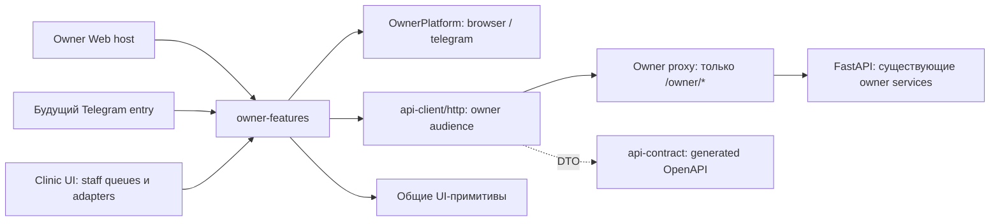

# Owner Web и Telegram Mini App

## Результат выделения

`apps/owner-web` — самостоятельный Next.js host: `/` → `/cabinet`, `/join`,
`/join/[code]`, `/cabinet`, собственный `/api/[...path]`. Он собирается и
запускается без исходников, маршрутов, auth-provider и shell из `apps/clinic-web`.
Его Docker image использует только owner host и `packages/`.

Общий функциональный код находится в `packages/owner-features`. Старые owner
маршруты Clinic UI используют совместимые re-export того же кода. Это позволяет
сначала проверить новый host, затем переключить трафик без второй реализации.



## Инвентаризация сценариев и зависимостей

| Область | Владелец | Что остаётся у staff | Устранённая зависимость |
| --- | --- | --- | --- |
| Регистрация | Preview врача, ввод кода, регистрация, переход в кабинет | Генерация стабильного кода для врача и workspace | `next/navigation` заменён платформенной навигацией |
| Авторизация и профиль | `/owner/me`, login/logout, изменение контактов | module-auth, refresh, организация и instance lock | Owner HTTP client не регистрирует и не вызывает staff recovery |
| Паспорта | Список, создание и редактирование имени, вида, породы, пола и даты рождения | Принятие регистрации, связывание с Client/Patient, клиническая карточка | Passport labels вынесены из `patients/form` в общий domain |
| Chat | Переписка по животному до и после принятия регистрации | Очередь регистраций, patient chat, staff ACL и право ответа | Один компонент chat с передаваемым transport; staff transport и `useAuth` остаются в Clinic UI |
| Visit requests | Предлагаемое время, ответы, отправка, статусы, withdraw/cancel | Confirm/reject, фактическое время, расписание и encounter | Типы визитов и подписи больше не импортируются из staff appointments |
| Questionnaires | Загрузка актуальной опубликованной анкеты для типа визита, обязательность ответов | Редактор и публикация анкеты пригласившим врачом | Owner получает DTO из общего OpenAPI-контракта |
| Attachments | Multipart upload на существующую заявку, повтор только неуспешных загрузок, скачивание своих и явно открытых файлов | Галерея, visibility toggle, хранение и проверка прав | DOM Blob download вынесен в платформенный `saveFile` |

`registration-queue`, `visit-request-queue`, `join-code-settings`,
`visit-questionnaire-editor` и `patient-chat` остаются в Clinic UI. Название старой
папки `owner-cabinet` у этих staff-модулей сохранено ради ограниченного переноса.

`packages/ui` содержит общие примитивы, date helpers и тему. Clinician-specific
CSS, печатные отчёты и оформление рабочих областей остаются в Clinic UI.
Обратных импортов из общих пакетов в приложения нет.

## Контракты, авторизация и файлы

- Источник API DTO — `packages/api-contract` и серверные Pydantic schemas.
  Выделение не меняет HTTP-контракты, БД и доменные сервисы.
- Общий `createHttpClient` вынесен из прежнего browser client в
  `packages/api-client/http`. Каждый экземпляр владеет своим recovery state.
  Owner audience разрешает только `/owner/*`, не добавляет workspace и не
  выполняет staff recovery при 401. Staff facade сохраняет текущий refresh flow.
- Авторизация владельца остаётся серверной `vetapp_owner_session`: HttpOnly,
  host-only, с текущими Secure/SameSite, 30 дней. Пароль и session token не
  передаются в Telegram SDK, URL или localStorage.
- Новый owner proxy принимает только owner routes, проверяет Origin и CSRF для
  изменений, передаёт только owner-cookie, удаляет Authorization и workspace.
  Ответы не кэшируются. JSON, multipart и бинарные ответы идут через один proxy.
- Backend CSRF/CORS допускает дополнительно точный `OWNER_FRONTEND_URL`.
  Этот параметр также задаёт origin ссылки `/join/{code}`. Без параметра
  сохраняется прежний `FRONTEND_URL`. Код и doctor/workspace binding не меняются.
- Скачивание сначала проходит авторизованный API-запрос, затем adapter получает
  Blob и имя файла. Telegram adapter не получает публичный URL закрытого файла.
- На сервере остаются прежние ограничения: 8 MiB, JPEG/PNG/WebP/GIF/PDF,
  изоляция животных и владельцев, явная видимость файлов врача. Неуспешный upload
  не создаёт повторную заявку и не пересылает уже загруженные файлы.

Принятие регистрации, связывание пациентов, права организации, запрет второго
врача и авторство анкеты остаются серверными правилами. Telegram user ID и
`start_param` не могут выбрать врача или workspace вместо проверенного join code.

## Минимально безопасное переключение

1. **Общие модули и совместимость.** Уже выполнено: оба host используют один
   owner feature package; старые owner routes продолжают работать.
2. **Самостоятельный host.** Уже выполнено: отдельные build/start, API proxy,
   env example и Docker image. Проверить owner login, passport, chat, questionnaire,
   visit и attachments на тестовом окружении с тем же API и хранилищем файлов.
3. **Переключение трафика.** Для сохранения действующих cookie оставить origin
   и публичные пути. Reverse proxy направляет `/join`, `/join/*`, `/cabinet` и
   `/api/owner/*` в owner-web; `/api` нельзя отрезать от staff host целиком.
   Next assets обслуживаются отдельными host по правилам выбранного reverse proxy;
   при одном origin необходимо разнести asset paths/assetPrefix до переключения.
   Простой вариант независимого размещения — отдельный owner-домен.
4. **Отдельный origin.** Установить `OWNER_FRONTEND_URL` в API и owner host;
   обновится origin новых приглашений. Host-only cookie старого домена не
   переносится: на новом домене нужен обычный вход существующими email/password.
   Сохранять старые owner routes на период перехода; аккаунты и приглашения те же.
5. **Удаление совместимых routes.** Только после переключения действующих ссылок
   и проверки сессий. В этом изменении они сохранены, автоматического redirect
   между доменами нет. Откат — вернуть трафик прежнему host.

Не следует проксировать owner-домен через запущенный Clinic UI: owner-web
напрямую обращается к FastAPI по `API_INTERNAL_URL`.

## Платформы и следующий Telegram entry point

`OwnerPlatform` задаёт `navigate` и `saveFile`. Shared components и внутренние
ссылки используют этот интерфейс. Browser adapter выполняет Blob download;
Next host передаёт ему router. Default adapter сохраняет работу старых Clinic
routes без дополнительного provider.

`createTelegramPlatform` принимает явно переданный bridge (`ready`, `expand`),
навигацию и способ сохранения уже авторизованного Blob. Проверка с fake bridge
использует те же JoinForm и AnimalFiles. SDK не импортируется в feature modules.

Telegram entry point **ещё не включён**. Чтобы добавить его без копирования UI:

1. Создать host route/provider, загрузить Telegram SDK, передать bridge и вызвать
   `initialize`. При обычном открытии использовать browser adapter. Сохранить
   выбранный provider на маршрутах join/cabinet и подключить Telegram BackButton.
2. Реализовать и проверить сохранение файлов в целевых Telegram clients через
   `saveFile`; авторизованный Blob уже доступен. Не выдавать session cookie или
   долгоживущие публичные ссылки ради скачивания.
3. Сначала можно оставить существующий email/password login. Для Telegram SSO
   потребуется отдельный серверный обмен с проверкой подписи и срока `initData`,
   защитой от повторного использования и явной привязкой существующего owner.
   Непроверенный `initDataUnsafe` не является авторизацией. Наличие Telegram
   аккаунта не отменяет приглашения конкретного врача.
4. Для web-версии Telegram отдельно настроить frame policy выделенного entry:
   текущий Owner Web ставит `X-Frame-Options: DENY`. Проверить cookie в iframe и
   WebView; если потребуется иная owner-cookie policy, отделить её от staff
   cookie настроек и проверить CSRF. Глобально ослаблять staff SameSite нельзя.

Таким образом Telegram потребует host integration и проверки среды, а формы,
chat, visits, анкеты, API DTO и серверная бизнес-логика останутся общими.

## Запуск и проверка

```powershell
pnpm install --frozen-lockfile
# apps/owner-web/.env.local: API_INTERNAL_URL и OWNER_FRONTEND_URL из .env.example
# apps/api/.env: OWNER_FRONTEND_URL=http://127.0.0.1:3001 для локальных запросов
pnpm dev:api
pnpm dev:owner
```

Clinic UI для запуска owner-web не нужен. По умолчанию owner host — порт 3001,
API — 8000. Для production: `pnpm build:owner`, затем `pnpm start:owner`.
В Docker профиль `owner` добавляет отдельный сервис на loopback-порту 3004:

```powershell
pnpm compose --profile owner up -d --build
```

Заполнить `OWNER_FRONTEND_URL` фактическим внешним owner-origin в `infra/.env`.
По умолчанию Compose сохраняет текущий clinic-origin для прежних приглашений;
для отдельного домена его нужно изменить. Переключение внешнего reverse proxy
не выполняется автоматически.

Проверки: `pnpm check`, `pnpm test:web`, `pnpm api:check`, сборки обоих приложений,
`pytest tests/test_owner_cabinet.py tests/test_v1_api.py tests/test_animal_chat.py tests/test_visit_requests.py tests/test_multi_user_auth.py`. Owner tests покрывают
изоляцию импортов, proxy/CSRF/cookie, login/logout, регистрацию, паспорт,
анкеты, retry upload и скачивание через платформенный adapter. API tests
проверяют неизменность doctor binding, patient isolation и file visibility.

Проверено 2026-10-30: typecheck/lint, 68 web-тестов, 46 API-тестов, OpenAPI
snapshot, production build обоих host и standalone build owner host. HTTP smoke
запущенного owner host подтвердил HTML/CSS на `/join` и `/cabinet`, 404 для
`/patients` и `/api/patients`. Compose profile `owner` проходит config validation.
Docker image не удалось собрать в текущем окружении: Docker daemon недоступен.
Telegram SDK и реальные Telegram clients этим прогоном не проверялись.
